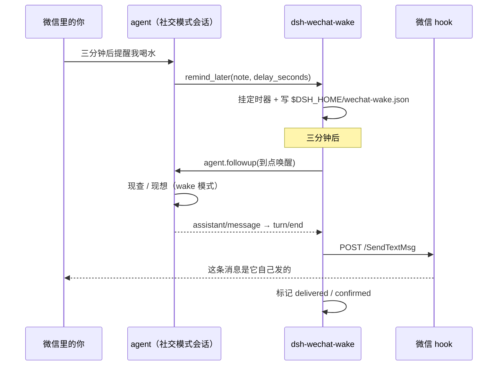

# dsh-wechat-wake —— 微信里的定时唤醒

[](https://github.com/deepseek-ai/deepseek-harness)
[](LICENSE)

给微信里的 agent 一组自己的定时工具：**到点它自己醒过来说话，说的话直接落进当前微信聊天**。

写给微信里的陪聊 / 人格会话用的。DSH 自带的 schedule 那套在这类会话里走不通：

| 现成的 | 卡在哪 |
|---|---|
| `@deepseek-ai/dsh-tool-schedule` | 社交模式下被 bridge 的 `controlTool` 前缀挡掉，工具根本不给看 |
| bridge 的「到点把结果发回微信」（`adoptScheduledTurn`） | 只在 `workMode === 'assistant'` 时执行 |

所以本插件用**不撞前缀**的工具名（`remind_*`）绕开第一道闸，用自己的 followup + 投递跑完整条链。

## 安装

```sh
# 让 dsh 自己把包挂进 profile（会读包里的 dsh.bundle.patch）
dsh plugin --profile web add github:heyikai060215-jpg/dsh-wechat-wake
```

手动安装（和本机其它 dsh-mod 插件一样）：

1. 把本仓库放到例如 `D:/dsh-mod/dsh-wechat-wake`
2. `profiles/<profile>/package.json` 的 `dependencies` 加 `"dsh-wechat-wake": "link:D:/dsh-mod/dsh-wechat-wake"`，`dsh.profile.bundles` 加 `"dsh-wechat-wake"`
3. `profiles/<profile>/node_modules/dsh-wechat-wake` 链到该目录（符号链接或 junction）
4. 重启 DSH，或改动 profile 的 `package.json` 触发一次热加载
5. 到 WeChatAgent 里给目标聊天勾上三个 `remind_*` 工具

装完先跑只读自检（**不发消息**，只查通道通不通）：

```sh
node tools/selftest.mjs wechat:private:<聊天号>
# 也可以直接给会话 id，脚本自己反查聊天键
node tools/selftest.mjs social-xxxxxxxx
```

通道都在的时候会打印 `reader / hook / chat / target / mode` 并返回 0；缺哪一项返回 1。

## 工具

| 工具 | 作用 |
|---|---|
| `remind_later(note, delay_seconds \| at, mode?)` | 定一条一次性唤醒。`mode=wake`（默认）到点开一轮；`mode=text` 原样发 note、不花模型 |
| `remind_list()` | 看这个会话还压着哪些没触发的、最近错过什么 |
| `remind_cancel(id)` | 取消一条 |

到点流程：复查聊天还在微信白名单 → `wake` 走 `agent.followup()` 叫醒会话 → 抓这一轮的正文（去掉 `RESPOND:` 前缀）→ 发到微信；没抓到正文 / 这一轮报错 / 超时 120 秒 → 退化成发 `⏰ note`，保证「到点一定有动静」。



## 实测记录

真机（微信私聊、社交模式、人格式会话）跑通的一条，状态文件里的原文：

```json
{
  "id": "rw-47b31757",
  "sessionId": "social-8b23659d…",
  "chat": "wechat:private:<聊天号>",
  "note": "本鲸来催了——喝水！快端起来灌两口，别让本鲸催第二遍哦 (￣^￣)",
  "mode": "text",
  "dueAt": 1793122435446,
  "state": "delivered",
  "firedAt": 1793122435479,
  "deliveredAt": 1793122436042,
  "confirmed": true
}
```

| 时刻 | 事件 |
|---|---|
| 01:30:55 | 会话那一轮的工具表里出现 `remind_later / remind_list / remind_cancel` |
| 01:30:55 | 模型自己调用 `remind_later`，选了 `mode: "text"` |
| 01:33:55.479 | 定时器触发（误差 0.5 秒内） |
| 01:33:56.042 | 投递完成，微信数据库回执 `confirmed: true` |

自检脚本的输出长这样：

```json
{
  "chat": true,
  "fromSession": "social-8b23659d…",
  "mode": "social",
  "reader": true,
  "hook": true,
  "target": "昵称 (wxid_…)"
}
```

`mode: "wake"`（到点真叫醒再说话）走同一条链路（`agent.followup()` + 抓 `turn/end` 正文），还没在「到点必须现查现说」的任务上单独验收——第一次用建议先这么试一次。

## 怎么授权（关键）

插件不自己判模式，**要不要给某个微信聊天用，仍然在 WeChatAgent 里按聊天勾选**：

- 界面：`聊天 → 设置此聊天 → 能力与权限`，勾上 `remind_later` / `remind_list` / `remind_cancel`
- 等价改文件：`config/wechatagent.json` → `wechat.dshAccess.chats["<聊天键>"].tools`

社交模式的聊天勾上就能用（这是本插件的目标场景）。助手模式的聊天**别勾**：那边原生 `schedule_create` 已经把结果转发得好好的，而且 bridge 对助手模式里任何「非请求的唤醒」都会查发起人，查不到就整轮报错——所以插件在助手模式被调用时会直接回一句「请改用 schedule_create」，不硬闯。

## 依赖的三条既有通道（不碰微信本体、不改 WeChatAgent 代码）

1. `state/accounts/<账号>/dsh-sessions.json` 的 `conversations`：会话 ↔ 聊天
2. `state/wechat-io-config.json` 的 reader 地址和令牌：查 wxid、查回执
3. `state/hook/native-token.txt` + `POST http://127.0.0.1:30001/SendTextMsg`：发消息

和 `dsh-tts-bridge-wechatagent-bridge`（把朗读桥念的话发成微信语音条）用的是同一套。

## 状态与边界

- 待触发列表落在 `$DSH_HOME/wechat-wake.json`；进程重启后重新挂表
- 关着期间到点的：10 分钟内补发，更早的记成 `missed`（不补发，免得半夜收到一句不合时宜的提醒）
- 每个会话最多 12 条待触发，单条最长 7 天；两次发送至少隔 1.5 秒
- 投递前复查白名单；聊天被移出白名单 → 记 `skipped`，不发
- 直发 hook 绕过了 WeChatAgent 的发送队列（没有去重编号、没有重试队列），失败只记日志，不重试轰炸
- 只能唤醒**还活着**的会话；冷会话退化成发静态文本
- 依赖匹配版微信 + WeChatAgent 的 hook；微信升级导致 hook 偏移变化时，发送会失败（插件本身不用改）

## 安全与免责

- 这个插件**会真的往微信发消息**，而且用的是你本机的微信 hook。先在没人打扰的聊天里试，别直接挂到工作群。
- 它不读聊天记录、不上传任何数据；待触发列表只写本机 `$DSH_HOME`。
- 授权是逐聊天的：没在 WeChatAgent 里勾上，任何会话都调不到这三个工具。
- 按 MIT 提供，不附带任何担保；被微信风控、发错人、发错时间的风险请自行评估。

## 文件

```
package.json        main = lib/host.js，dsh.bundle.patch 指向 cordis.patch.yml
cordis.patch.yml    insert: { id: wechat-wake, name: 'dsh-wechat-wake' }
lib/host.js         三个工具 + 定时器 + 到点流程 + 状态持久化
lib/send.mjs        会话→聊天→wxid→SendTextMsg，外加只读探针 probe()
tools/selftest.mjs  命令行只读自检
```

## 卸载

1. `profiles/<profile>/package.json` 里删掉 `dsh-wechat-wake` 依赖和 `bundles` 里那一行
2. 删掉 `profiles/<profile>/node_modules/dsh-wechat-wake` 这个链接
3. 删掉仓库目录，以及 WeChatAgent 里的三个工具勾选
4. 想清干净的话再删 `$DSH_HOME/wechat-wake.json`

## License

MIT
